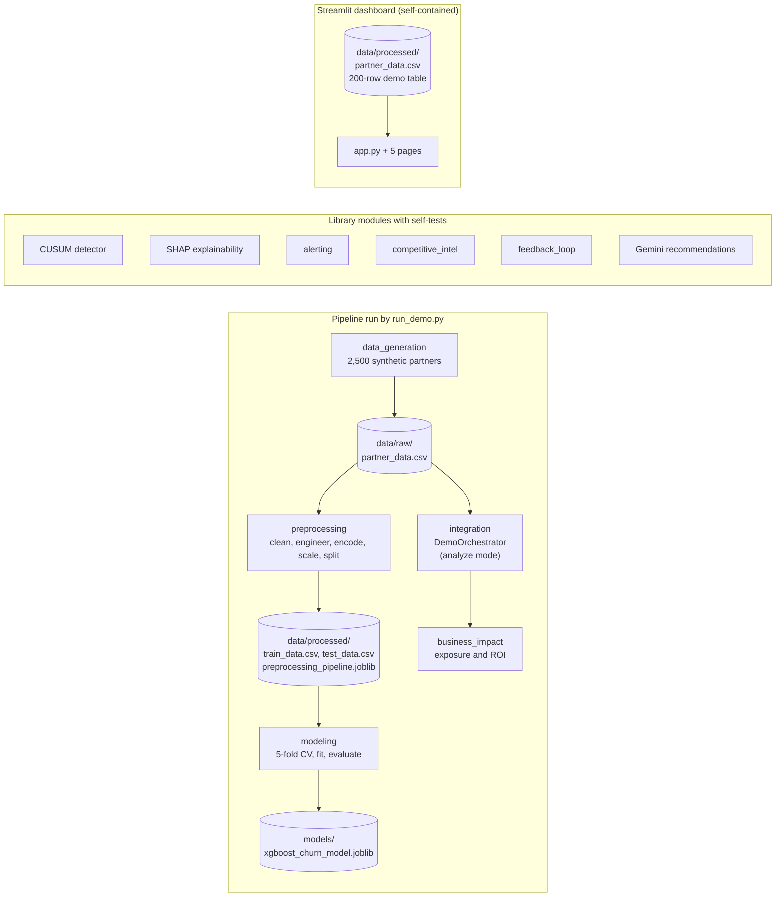
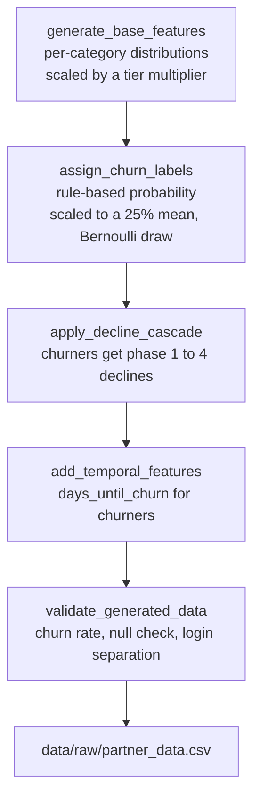
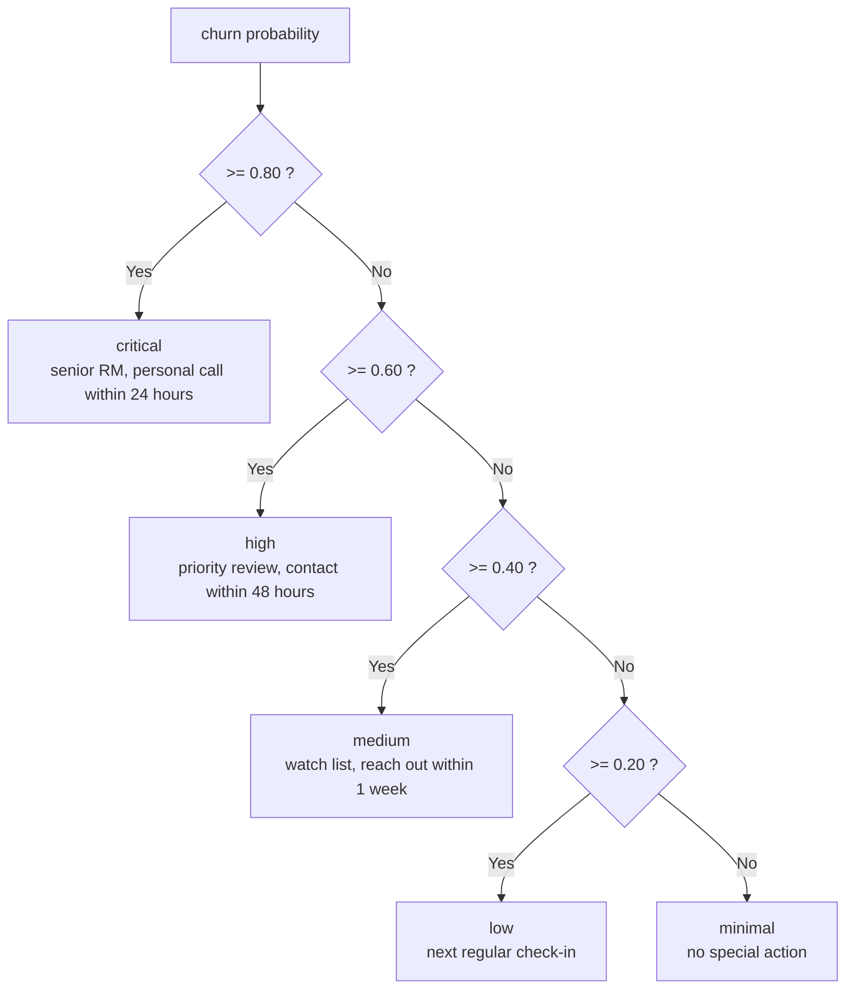
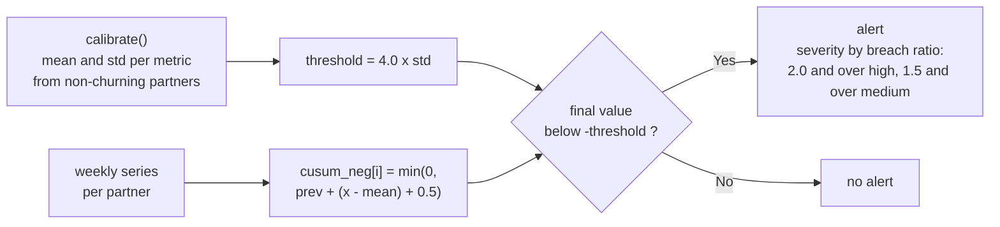
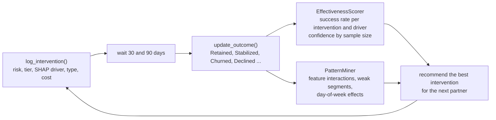
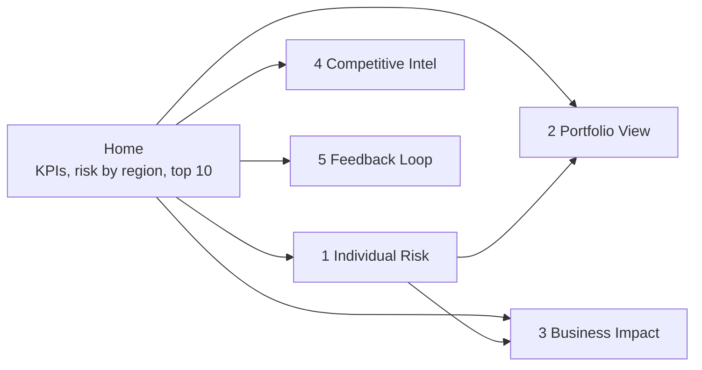

# Smart Partner Churn Prediction (Deriv AI Hackathon)

A hackathon prototype of an **AI early-warning system for partner churn**. It answers the challenge set in the Deriv AI Hackathon brief: which affiliate / introducing-broker partners are about to leave, why, how much money is at stake, and what a relationship manager should do about it before it is too late.

The project generates a **synthetic portfolio of 2,500 partners**, trains an **XGBoost** classifier on 75 features, and surrounds the model with analysis modules for **SHAP explanations**, **CUSUM drift detection**, **alerting and prioritisation**, **financial exposure and intervention ROI**, **competitor intelligence**, **Gemini-written retention advice** and an **intervention feedback loop**. A **Streamlit dashboard** presents a five-page demo. Everything runs locally from one script, `run_demo.py`.

> **All data in this repository is synthetic.** It is produced by code in `src/data_generation/` (and by a fallback generator inside the dashboard). No real partner, client or company data is used, and this is an independent hackathon project, not an official Deriv product. Read [What is real and what is simulated](#what-is-real-and-what-is-simulated) before drawing conclusions from any number the demo shows.

---

## Table of contents

1. [What problem it solves](#what-problem-it-solves)
2. [System overview](#system-overview)
3. [What is real and what is simulated](#what-is-real-and-what-is-simulated)
4. [Repository layout](#repository-layout)
5. [How the pipeline works](#how-the-pipeline-works)
6. [Analysis modules](#analysis-modules)
7. [The dashboard](#the-dashboard)
8. [Configuration reference](#configuration-reference)
9. [Data in the repository](#data-in-the-repository)
10. [Setup and run](#setup-and-run)
11. [Code walkthrough](#code-walkthrough)
12. [Results](#results)
13. [Troubleshooting](#troubleshooting)
14. [Security and data notes](#security-and-data-notes)
15. [Limitations and next steps](#limitations-and-next-steps)

---

## What problem it solves

The challenge brief (`AI Partner Churn Prediction & Early Warning System (1).pdf`, included in the repository) describes a familiar failure: partner churn is invisible until it is irreversible. Managers react to complaints after performance has already collapsed, and nobody can personally watch thousands of relationships.

| Need from the brief | Where this project addresses it |
|---|---|
| Early warning from activity trends (logins, referrals, commission, dashboard use) | Decline-cascade data model, trend features, CUSUM detector (`src/modeling/cusum_detector.py`) |
| Multi-signal risk scoring (behavioural, communication, relationship, financial, competitive) | 72 schema features in 8 categories (`config/feature_schema.py`), XGBoost classifier |
| Churn probability with risk tiers | Five tiers from `Config.RISK_TIERS`, `RiskTierAssigner` |
| Explainable predictions | `SHAPCalculator` and `DriverCategorizer` (library modules) |
| Priority ranking and real-time alerts | `PriorityScorer`, `InterventionWindowCalculator` (library modules) |
| Cohort or systemic-issue detection | `CohortDetector` (library module), cohort table on the Portfolio page |
| Intervention timing | `InterventionWindowCalculator` |
| Learning from outcomes | `InterventionTracker`, `EffectivenessScorer`, `PatternMiner` |
| Proactive, specific recommendations (GenAI) | `GeminiRecommender`, `StrategicResponder` with five prompt templates |
| Live demo on sample partner data | `run_demo.py` and the Streamlit dashboard |

---

## System overview



Three things are worth knowing about this picture:

- `run_demo.py` runs the left-hand pipeline: generate, preprocess, train, evaluate, then either launch the dashboard or print a terminal analysis.
- The modules in the middle box are complete, documented classes, each with an `if __name__ == "__main__"` self-test, but they are **not called by `run_demo.py` or by the dashboard**. They are building blocks for a production system.
- The dashboard has its **own** data and its **own** copies of the scoring logic. It does not load the trained model.

---

## What is real and what is simulated

| Item | Status |
|---|---|
| Partner records | Synthetic. Drawn from random distributions in `generate_base_features.py` |
| Churn labels | Synthetic. Drawn from a hand-written rule-based probability in `apply_decline_cascade.py`, so a model trained on them recovers those rules rather than real-world behaviour |
| XGBoost model | Trained on the synthetic data; hyperparameters are in `config/config.py` |
| Model metrics | **Not stored in the repository**; run `python run_demo.py --mode train` to produce them |
| Dashboard risk scores | Rule-based scores in the 200-row demo table, not model output |
| Dashboard "SHAP" bar chart | Illustrative bars chosen by if-statements on partner values, not computed SHAP values |
| Dashboard engagement timeline, 12-month risk trend | Random walks with fixed seeds |
| Dashboard feedback-loop table | 50 randomly generated sample interventions |
| Dollar figures (commission by tier, intervention costs, success rates) | Assumptions set in `config/config.py`, not measured values |
| Gemini output | Real API call only when a working key and model are configured; otherwise canned or rule-based text |

---

## Repository layout

The repository root holds two folders. The runnable project is **one level further down, inside a nested folder**. All commands in this README are run from that inner folder.

```
Deriv-AI-Hackathon-Smart-Partner-Churn-Prediction/                 <- repository root
├── Deriv-AI-Hackathon-Smart-Partner-Churn-Prediction-master (2)/
│   └── Deriv-AI-Hackathon-Smart-Partner-Churn-Prediction-master/  <- the runnable project
│       ├── run_demo.py                  # Entry point: generate, preprocess, train, evaluate, dashboard
│       ├── AI Partner Churn Prediction & Early Warning System (1).pdf   # Hackathon challenge brief (3 pages)
│       ├── Team35_Churn Partner Prediction.zip   # Archive of this same project (same files, plus a .gitignore)
│       │
│       ├── config/
│       │   ├── config.py                # All parameters: distributions, XGBoost, CUSUM, tiers, costs, Gemini
│       │   └── feature_schema.py        # 72 features in 8 categories, with ranges and CUSUM flags
│       │
│       ├── src/
│       │   ├── data_generation/         # generate_base_features, apply_decline_cascade, generate_data_main
│       │   ├── preprocessing/           # preprocess_main (cleaning, engineering, encoding, scaling, split)
│       │   ├── modeling/                # train_xgboost, evaluate_model, cusum_detector
│       │   ├── explainability/          # shap_calculator, driver_categorizer
│       │   ├── alerting/                # risk_tier_assignment, priority_scoring, intervention_window, cohort_detection
│       │   ├── business_impact/         # financial_exposure, intervention_roi, portfolio_aggregation, scenario_modeling
│       │   ├── competitive_intel/       # competitor_extraction, geographic_mapping, segment_vulnerability,
│       │   │                            #   threat_clustering, strategic_response
│       │   ├── recommendations/         # gemini_integration, prompt_templates
│       │   ├── feedback_loop/           # intervention_tracker, effectiveness_scorer, pattern_mining
│       │   └── integration/             # demo_orchestrator
│       │
│       ├── dashboard/
│       │   ├── app.py                   # Home page and sidebar navigation
│       │   ├── pages/                   # 1_Individual_Risk ... 5_Feedback_Loop
│       │   └── components/              # Reusable chart, metric and table helpers (not used by the pages)
│       │
│       ├── data/
│       │   ├── raw/partner_data.csv                 # 2,500 generated partners, 75 columns
│       │   └── processed/                           # train/test CSVs, scaler, 200-row dashboard demo table
│       └── models/xgboost_churn_model.joblib        # Trained model (pickle)
│
└── Partner Churn Prediction System/
    ├── Dataset/                         # 8 category CSVs, 2,500 rows each (a different, earlier feature design)
    ├── Dataset_3.ipynb                  # Empty file (0 bytes)
    └── Deriv_Churn_Strategy_v2_Full_Coverage.docx   # Data-science strategy document
```

The `Dataset/` CSVs follow the feature categories of the strategy document and are **not read by any code** in the project; the `src/` pipeline uses its own generator and schema.

---

## How the pipeline works

`run_demo.py` has five modes and a `--skip-dashboard` flag:

| Command | What happens |
|---|---|
| `python run_demo.py` (same as `--mode full`) | Generate data, preprocess, train, evaluate, then launch the dashboard |
| `python run_demo.py --mode full --skip-dashboard` | Same, but ends with a terminal analysis instead of the dashboard |
| `python run_demo.py --mode train` | Generate, preprocess, train, evaluate, then stop |
| `python run_demo.py --mode generate` | Generate the synthetic dataset only |
| `python run_demo.py --mode analyze` | Terminal analysis of the top five partners and the portfolio, from `data/raw/partner_data.csv` (a 100-row random table is used if that file is missing) |
| `python run_demo.py --mode dashboard` | Launch the Streamlit dashboard only |

### 1. Data generation (`src/data_generation/`)



- **Base features.** Eight generator functions, one per category A to H of `FeatureSchema`, produce the columns. Platinum, gold, silver and bronze partners are scaled by multipliers of 3.0, 2.0, 1.2 and 1.0.
- **Labels.** `calculate_churn_probability` starts at 25% and adds or subtracts for tier, tenure, commission trend, escalations, complaints, competitor mentions, pricing complaints and login frequency, then clips to 5%-70%. Probabilities are rescaled so the mean equals the target churn rate, and each partner is labelled by a random draw. If the realised rate is more than two points from 25%, labels are flipped to hit the target.
- **Decline cascade.** Each churner is assigned a phase and every phase up to it is applied cumulatively:

| Phase | Probability of being the churner's final phase | Design intent (`Config.DECLINE_CASCADE`) | Main effects |
|---|---|---|---|
| 1 | 10% | 8-12 weeks before churn | Logins -10 to -20%, session duration -5 to -15%, dashboard clicks -10 to -25% |
| 2 | 20% | 4-8 weeks before | Logins -20 to -40%, support tickets +20 to +50%, event attendance -30 to -50%, training completion -20 to -40%, more escalations |
| 3 | 35% | 2-4 weeks before | New client sign-ups -20 to -40%, client retention -10 to -30%, commission -15 to -35% |
| 4 | 35% | 0-2 weeks before | Logins -50 to -80%, commission -30 to -60%, active clients -20 to -40%, more competitor mentions, lower sentiment and NPS, more frustration and churn-intent signals |

- **Temporal feature.** Churners receive `days_until_churn` drawn from 7, 14, 21, 30, 45 or 60 days (15%, 20%, 25%, 20%, 12%, 8%).
- **Optional time series.** Running `src/data_generation/generate_data_main.py` directly also writes `data/raw/partner_timeseries.csv` (500 partners by 12 weeks) for CUSUM experiments. `run_demo.py` does not.

### 2. Preprocessing (`src/preprocessing/preprocess_main.py`)

1. **Clean:** drop duplicate `partner_id`s, fill numeric gaps with the median and categorical gaps with the mode, clip four key columns to wide percentile-based bounds.
2. **Engineer:** four composite scores (`engagement_score`, `revenue_health_score`, `client_health_score`, `risk_indicator`) and a `tenure_bucket` used only for cohort analysis.
3. **Exclude from the model:** `partner_id`, `churned`, `churn_probability`, `days_until_churn`, `tenure_bucket`. This leaves **75 input columns**.
4. **Split:** 80% train and 20% test, stratified, seed 42 (2,000 and 500 rows in the committed splits).
5. **Encode and scale:** `tier`, `partner_type` and `region` are label-encoded; numeric columns are standardised; the scaler is fitted on the training split only.
6. **Save:** `train_data.csv`, `test_data.csv` and `preprocessing_pipeline.joblib` in `data/processed/`.

### 3. Model (`src/modeling/train_xgboost.py`)

`ChurnPredictor` wraps `XGBClassifier` with the parameters from `Config.XGBOOST_PARAMS` (200 trees, depth 6, learning rate 0.1, `scale_pos_weight` 3 for the 3:1 class imbalance, `aucpr` evaluation metric). Training does a stratified 5-fold cross-validated ROC-AUC on the training split, fits on the full training split, prints the ten most important features and saves the model, feature names, importances and parameters in `models/xgboost_churn_model.joblib`. The test split is passed as an evaluation set for logging only; early stopping is not used.

### 4. Evaluation (`src/modeling/evaluate_model.py`)

`generate_evaluation_report` prints accuracy, precision, recall, F1, ROC-AUC, PR-AUC, the confusion matrix, the number of churners caught and missed, capture rate (recall) at thresholds 0.3, 0.5 and 0.7, the F1-optimal threshold (scanned from 0.10 to 0.85), an estimated business impact and a classification report.

### 5. Risk tiers



---

## Analysis modules

| Area | Module (`src/...`) | What it does | Wired into |
|---|---|---|---|
| Data | `data_generation/*` | Synthetic partners and decline cascade | `run_demo.py` |
| Data | `preprocessing/preprocess_main.py` | Clean, engineer, encode, scale, split | `run_demo.py` |
| Model | `modeling/train_xgboost.py`, `evaluate_model.py` | Train, cross-validate, evaluate | `run_demo.py` |
| Early warning | `modeling/cusum_detector.py` | CUSUM on weekly series of five key metrics | Self-test only |
| Explainability | `explainability/shap_calculator.py` | TreeSHAP global and per-partner drivers, summaries | Self-test; orchestrator uses it only if given a model |
| Explainability | `explainability/driver_categorizer.py` | Maps features to eight business categories, readable labels, intervention hints per category | Self-test |
| Alerting | `alerting/risk_tier_assignment.py` | Probability to tier, tier summaries and transitions | Self-test |
| Alerting | `alerting/priority_scoring.py` | Risk, value and trend combined into a 0-100 priority score; RM capacity and hours | Self-test |
| Alerting | `alerting/intervention_window.py` | Estimated days to churn, deadline, urgency, recommended action, weekly calendar | Self-test |
| Alerting | `alerting/cohort_detection.py` | Finds regions, tiers, types and tenure groups whose average risk is well above baseline | Self-test |
| Business | `business_impact/financial_exposure.py` | Annual value, expected loss, value at risk | `run_demo.py --mode analyze` |
| Business | `business_impact/intervention_roi.py` | ROI per intervention type, best-intervention choice, portfolio ROI | `run_demo.py --mode analyze` |
| Business | `business_impact/portfolio_aggregation.py` | Portfolio and tier roll-ups of exposure | Created by the orchestrator, self-test |
| Business | `business_impact/scenario_modeling.py` | Budget scenarios and strategy comparison | Self-test |
| Competitive | `competitive_intel/competitor_extraction.py` | Keyword matching for 18 competing brokers, sentiment heuristic, threat types, quotes | Self-test |
| Competitive | `competitive_intel/geographic_mapping.py` | Regional threat levels and priority regions | Self-test |
| Competitive | `competitive_intel/segment_vulnerability.py`, `threat_clustering.py` | Segment vulnerability scores, threat-type clusters | Self-test |
| GenAI | `competitive_intel/strategic_response.py` | Counter-move advice per threat region (Gemini or rule-based) | Self-test |
| GenAI | `recommendations/gemini_integration.py`, `prompt_templates.py` | Retention, competitive, financial, support and cohort prompts | Self-test |
| Feedback | `feedback_loop/*` | Intervention log, effectiveness scoring, pattern mining | Self-test |
| Integration | `integration/demo_orchestrator.py` | Runs per-partner and portfolio analysis in `--mode analyze` | `run_demo.py` |

### CUSUM early warning

CUSUM accumulates small deviations from a baseline so a persistent decline is caught even when no single week looks alarming.



Monitored metrics: `login_frequency_weekly`, `commission_current_month`, `client_signup_rate`, `session_duration_avg`, `active_clients_count`. Detection needs at least four periods. The code also has an upward-CUSUM branch for support tickets, escalations and competitor mentions, but those metrics are not in the default monitored list, so it stays inactive unless you add them to `features_to_monitor`. `Config.CUSUM_CONFIG['alert_window_days']` (21) is used by the intervention-window module, which caps the estimated days to churn at 21 when a CUSUM alert is active.

### Priority score and intervention window

```
priority = 0.5 x (churn probability x 100)
         + 0.3 x min(100, monthly commission / 50,000 x 100 x tier multiplier)
         + 0.2 x trend score        # +20 worsening, 0 stable, -20 improving
clipped to 0-100;  urgent >= 80, high >= 60, medium >= 40, low >= 20
```

The intervention window starts from 14, 30, 60 or 90 days for probabilities of at least 0.8, 0.6, 0.4 or below, shortens by 30% for a worsening trend, lengthens by 30% for an improving one, is capped at 21 days when CUSUM has fired, and sets the intervention deadline seven days before the estimated churn date.

### Financial exposure and intervention ROI

| Intervention (`Config`) | Cost (USD) | Baseline success rate |
|---|---|---|
| personal_call | 50 | 15% |
| account_review | 100 | 25% |
| custom_incentive | 500 | 40% |
| strategic_meeting | 1,000 | 50% |
| retention_package | 2,500 | 65% |

Success rates are multiplied by a tier factor (platinum 1.30, gold 1.15, silver 1.00, bronze 0.85) and clamped to 10%-90%. These numbers are **placeholder assumptions** chosen by the authors.

### Feedback loop



`InterventionTracker` persists to `data/intervention_outcomes.csv`, created on first use. Confidence labels are HIGH at 30 or more interventions, MEDIUM at 10, LOW at 3.

---

## The dashboard

Start it with `python run_demo.py --mode dashboard` (or `streamlit run dashboard/app.py`) and open `http://localhost:8501`. Always enter through the Home page: the other pages read the data from Streamlit session state and show an error if opened directly.



| Page | What it shows | Notes |
|---|---|---|
| Home (`app.py`) | High, medium and low risk counts (cut-offs 0.7 and 0.4), annual portfolio value, stacked risk-by-region chart, top-10 at-risk table | Reads `data/processed/partner_data.csv`; generates and saves a 200-row table if it is missing |
| 1 Individual Risk | Partner selector sorted by risk, five-band gauge, profile, key metrics, driver bars, up to four recommended interventions, financial impact | Driver bars and timeline are illustrative; interventions are rules on probability, tier and competitor mentions; the risk-level filter is not applied |
| 2 Portfolio View | Risk distribution donut, tier by region heatmap, 12-month high-risk trend, cohort table, risk by tier | Trend is simulated; a cohort is flagged when average risk is at least 50% and it has at least five partners |
| 3 Business Impact | Annual value, value at risk, expected loss (80% of value at risk), tier waterfall, regional split, ROI calculator with a USD 5,000-50,000 budget slider | ROI uses per-tier costs of 800, 500, 300, 150 and a flat 65% success rate |
| 4 Competitive Intel | Partners naming a competitor, competitor bar chart, regional penetration heatmap, alert level (HIGH from 25%, WATCH from 15%), counter-move cards | Counter-moves are rules keyed to five named competitors |
| 5 Feedback Loop | Success rate by intervention type, weekly success trend, recent interventions, form to log a new one | Starts with 50 random sample interventions; new entries live in the session only |

---

## Configuration reference

All values are in `config/config.py` unless stated.

| Setting | Default | Effect |
|---|---|---|
| `N_PARTNERS` | 2500 | Synthetic partners generated |
| `CHURN_RATE` | 0.25 | Target share of churners |
| `RANDOM_SEED` | 42 | Seed for generation, split and model |
| `TIER_DISTRIBUTION` | platinum 5%, gold 15%, silver 35%, bronze 45% | Partner tier mix |
| `TYPE_DISTRIBUTION` | affiliate 40%, ib 35%, master_affiliate 15%, payment_agent 10% | Partner type mix |
| `REGION_DISTRIBUTION` | asia_pacific 30%, europe 25%, latin_america 20%, africa 15%, middle_east 10% | Region mix |
| `TEST_SIZE` | 0.2 | Hold-out share |
| `XGBOOST_PARAMS` | 200 trees, depth 6, lr 0.1, subsample 0.8, colsample 0.8, `scale_pos_weight` 3 | Model hyperparameters |
| `CUSUM_CONFIG` | threshold multiplier 4.0, drift 0.5, minimum 4 periods, 21-day alert window | CUSUM sensitivity |
| `RISK_TIERS` | critical 0.80, high 0.60, medium 0.40, low 0.20, minimal 0.00 | Tier cut-offs and colours |
| `COHORT_CONFIG` | minimum cohort 3, dimensions region, tier, type, tenure bucket | Cohort detection (lift threshold 1.5 is set in `CohortDetector`) |
| `SHAP_CONFIG` | top 5 drivers | Drivers shown per partner |
| `FEEDBACK_CONFIG` | 90-day tracking, 20 interventions before learning, retrain after 100 | Defined but not read by any code |
| `GEMINI_MODEL` | `gemini-1.5-flash` | **Retired by Google, see [Troubleshooting](#troubleshooting)** |
| `GEMINI_API_KEY` | from environment | Read from `GEMINI_API_KEY` or `GOOGLE_API_KEY` |

---

## Data in the repository

Facts below were measured from the committed files.

| File | Rows | Notes |
|---|---|---|
| `data/raw/partner_data.csv` | 2,500 | 75 columns: `partner_id`, 71 features, `churn_probability`, `churned`, `days_until_churn`; 625 churners (25.0%) |
| `data/processed/train_data.csv` | 2,000 | 75 inputs plus `churned`, churn rate 25% |
| `data/processed/test_data.csv` | 500 | Same columns, churn rate 25% |
| `data/processed/preprocessing_pipeline.joblib` | | Fitted `StandardScaler` and label encoders |
| `data/processed/partner_data.csv` | 200 | Dashboard demo table, 17 columns, regions SEA, MENA, Europe, Africa, LATAM |
| `models/xgboost_churn_model.joblib` | | `XGBClassifier`, 200 trees, depth 6 |
| `Partner Churn Prediction System/Dataset/*.csv` | 2,500 each | Eight category files, unused by the code |

A mean comparison from `data/raw/partner_data.csv`:

| Metric (mean) | Retained | Churned |
|---|---|---|
| Weekly logins | 7.89 | 5.12 |
| Average sentiment | 0.30 | 0.18 |

> **Check this before trusting any model score.** In the committed `data/raw/partner_data.csv`, all 129 platinum partners are labelled as churned (gold 49.6%, silver 17.3%, bronze 13.6%), although their `churn_probability` is the lowest of any tier (platinum mean 0.07). The labelling code in this repository draws labels from that probability, so this skew is not what it would be expected to produce, and the file may come from an earlier version of the generator. The committed training and test splits and the committed model inherit it, so tier alone separates platinum churners perfectly. Regenerate everything with `python run_demo.py --mode train` for a self-consistent dataset.

---

## Setup and run

### 1. Prerequisites

- Python 3.10 or newer (the project's bytecode in the git history is from Python 3.10)
- Optional: a Gemini API key for the GenAI modules

### 2. Get the code and open the inner project folder

```bash
git clone https://github.com/faiyaadmahabub-hash/Deriv-AI-Hackathon-Smart-Partner-Churn-Prediction.git
cd Deriv-AI-Hackathon-Smart-Partner-Churn-Prediction
cd "Deriv-AI-Hackathon-Smart-Partner-Churn-Prediction-master (2)/Deriv-AI-Hackathon-Smart-Partner-Churn-Prediction-master"
```

Keep the quotes: the folder name contains spaces and parentheses.

### 3. Create an environment and install

```bash
python -m venv .venv
source .venv/bin/activate          # Windows: .venv\Scripts\activate
pip install pandas numpy scikit-learn xgboost joblib python-dotenv streamlit plotly
```

Optional packages:

```bash
pip install shap                   # SHAP explanations (explainability module)
pip install google-generativeai    # imported by the Gemini modules (deprecated SDK, see Troubleshooting)
```

The repository has no `requirements.txt`. An earlier version in the git history listed `pandas>=2.0.0`, `numpy>=1.24.0`, `scikit-learn>=1.3.0`, `xgboost>=2.0.0`, `shap>=0.42.0`, `streamlit>=1.28.0`, `google-generativeai>=0.3.0`, `plotly>=5.18.0`, `python-dotenv>=1.0.0`, `joblib>=1.3.0`. The committed `.joblib` files were saved with NumPy 2.x (they reference `numpy._core`), so older NumPy versions may fail to load them; if you hit a pickle error, regenerate them with step 4.

### 4. Generate data and train

```bash
python run_demo.py --mode train
```

This regenerates `data/raw/` and `data/processed/`, trains the model into `models/`, and prints the cross-validation score and the evaluation report.

### 5. Run the demo

```bash
python run_demo.py --mode dashboard              # Streamlit dashboard on http://localhost:8501
python run_demo.py --mode analyze                # terminal analysis, no dashboard
python run_demo.py                               # everything, then the dashboard
```

### 6. Try individual modules

Each module has a self-test block that runs on built-in sample data. Run these from the inner project folder:

```bash
python src/modeling/cusum_detector.py
python src/alerting/cohort_detection.py
python src/alerting/priority_scoring.py
python src/business_impact/scenario_modeling.py
python src/competitive_intel/competitor_extraction.py
```

### 7. Optional: enable Gemini

Create a file named `.env` in the inner project folder:

```
GEMINI_API_KEY=your-key-here
```

This repository does not ship a `.gitignore`, so add `.env` to one before committing anything. Without a key the Gemini modules fall back to canned or rule-based text. Note that Gemini 1.5 Flash is no longer served, so set a current model name first (see [Troubleshooting](#troubleshooting)).

---

## Code walkthrough

**Model hyperparameters** (`config/config.py`):

```python
XGBOOST_PARAMS = {
    'n_estimators': 200,
    'max_depth': 6,
    'learning_rate': 0.1,
    'subsample': 0.8,
    'colsample_bytree': 0.8,
    'min_child_weight': 3,
    'gamma': 0.1,
    'reg_alpha': 0.1,
    'reg_lambda': 1.0,
    'scale_pos_weight': 3,  # Handle class imbalance
    'random_state': RANDOM_SEED,
    'n_jobs': -1,
    'eval_metric': 'aucpr'
}
```

**CUSUM recursion** (`src/modeling/cusum_detector.py`):

```python
for i in range(1, n):
    deviation = values[i] - reference_mean
    cusum_pos[i] = max(0, cusum_pos[i - 1] + deviation - drift)   # upward shifts
    cusum_neg[i] = min(0, cusum_neg[i - 1] + deviation + drift)   # downward shifts
```

A negative alert fires when the last `cusum_neg` value is below `-threshold`, where the threshold is the baseline standard deviation times `threshold_multiplier`.

**Financial exposure** (`src/business_impact/financial_exposure.py`):

```python
annual_value = monthly_commission * 12
expected_annual_loss = annual_value * churn_probability
avg_remaining_months = max(0, 36 - tenure_months)          # assumes a 3-year partner lifetime
lifetime_value_remaining = monthly_commission * avg_remaining_months
value_at_risk = lifetime_value_remaining * churn_probability
```

**Gemini with a safe fallback** (`src/competitive_intel/strategic_response.py`): the module only calls Gemini if the package imports and a key is set, and otherwise returns a rule-based recommendation tagged `source: rule_based`.

---

## Results

**The repository stores no model evaluation output**, so this README does not quote accuracy, ROC-AUC, PR-AUC or any other model metric. `python run_demo.py --mode train` prints them: the 5-fold cross-validated ROC-AUC, then the full report (accuracy, precision, recall, F1, ROC-AUC, PR-AUC, confusion matrix, capture rates at 0.3, 0.5 and 0.7, F1-optimal threshold, estimated business impact). Because the labels are synthetic and rule-generated, treat those numbers as a check that the pipeline works, not as evidence of real-world predictive power.

The strategy document (`Deriv_Churn_Strategy_v2_Full_Coverage.docx`) sets these **design targets**. They are goals, not measured results, and the code does not currently compute the F2 score, Brier score or lead time:

| Metric | Target in the strategy document |
|---|---|
| Recall | above 85% |
| Precision | above 60% |
| PR-AUC | above 0.75 |
| F2 score | above 0.78 |
| Brier score | below 0.15 |
| Lead time before churn | above 21 days |

What the demo does show reliably: the generated data has the intended 25% churn rate, churners log in less and have lower sentiment than retained partners, and the dashboard and orchestrator turn probabilities into tiers, exposure and ROI figures.

---

## Troubleshooting

| Problem | What to check |
|---|---|
| `ModuleNotFoundError: dotenv` | `config/config.py` imports `python-dotenv` at start-up: `pip install python-dotenv` |
| `ModuleNotFoundError: streamlit` or `plotly` | Install both for the dashboard |
| Dashboard page says "Please navigate from the main dashboard" | Open the Home page first; pages read data from session state |
| Pickle or NumPy error loading `.joblib` files | The committed files were saved with NumPy 2.x. Run `python run_demo.py --mode train` to recreate them with your versions |
| `FileNotFoundError` for `train_data.csv` when running a module directly | Run `python run_demo.py --mode train` first |
| Gemini returns 404, or text that looks generic | `gemini-1.5-flash` was shut down by Google on 29 September 2025 ([Gemini API changelog](https://ai.google.dev/gemini-api/docs/changelog)), and the `google-generativeai` SDK is [deprecated](https://github.com/google-gemini/deprecated-generative-ai-python) in favour of the unified `google-genai` SDK. The code catches the error and returns canned (`GeminiRecommender`) or rule-based (`StrategicResponder`) text, so failures are easy to miss. Update `GEMINI_MODEL` and the SDK call |
| `--mode analyze` shows 0 high-risk partners | That mode reads `churn_probability` from the generated CSV, whose maximum is 0.577 in the committed data, and counts "high" as 0.7 and above |
| Shell cannot find the project folder | Quote the path: it contains spaces and parentheses |

---

## Security and data notes

- Keep API keys in environment variables or an untracked `.env`. Never commit them.
- `.joblib` files are Python pickles. Loading a pickle runs code, so only load model files you trust. Listing the imports of this repository's two `.joblib` files (without loading them) shows only XGBoost, scikit-learn, NumPy, pandas and joblib helper classes, but regenerating them with `--mode train` is safer than trusting any committed binary.
- The synthetic data is built to look plausible. Do not use it, or numbers derived from it, as evidence about real partners.

---

## Limitations and next steps

- **Synthetic, rule-generated labels.** Any model score measures how well XGBoost recovers the generator's rules. Validation on real partner history is the single most important missing step.
- **Skewed committed data.** See the warning in [Data in the repository](#data-in-the-repository): platinum partners are 100% churned in the committed CSV, splits and model.
- **No stored metrics, no calibration, one split.** Evaluation is a single 80/20 split at a 0.5 threshold. Normalisation constants and percentile clipping are computed on the full dataset before the split, which is a small leak.
- **The dashboard is not connected to the model.** It uses its own 200-row table with hand-set risk rules, illustrative driver bars, random-walk trends and random sample interventions. Wiring it to `ChurnPredictor`, `SHAPCalculator` and the alerting modules is the natural next step.
- **Orchestrator defects.** `DemoOrchestrator` calls `predict_proba(...)[0][1]` on a one-dimensional array from `ChurnPredictor`, which would raise and fall back to 0.5; and `format_demo_output` reads a `roi` key that the ROI calculator names `roi_percent`, so the printed ROI is always 0.0x. `run_demo.py` currently avoids the first by not passing a model.
- **Inconsistent definitions.** Five risk tiers in config, but three bands (0.7 and 0.4) on the dashboard and in several modules; region names `asia_pacific, europe, ...` in the generator but `SEA, MENA, ...` in the dashboard; success outcomes are Retained and Stabilized in some modules and also Recovered in others.
- **Column mismatches.** The dashboard table has `days_since_last_login`, `unresolved_tickets_count` and `primary_competitor`, which the generator does not produce, and `PatternMiner`'s default feature pairs use column names from the strategy document that do not exist in either table, so those pairs are skipped.
- **Strategy document and code have drifted.** The document describes a 70/15/15 split, six regions, a 60/40 affiliate-to-IB mix and a logistic-regression benchmark; the code uses an 80/20 split, five regions, four partner types and no benchmark.
- **CUSUM is not validated.** The module docstring claims 3+ weeks of early warning, but the repository has no backtest of lead time on a real or simulated time series beyond a built-in 12-week toy example.
- **Gemini integration is stale** (retired model and deprecated SDK) and fails silently into fallbacks.
- **Hard-coded business assumptions** (commission by tier, intervention costs and success rates, a 36-month partner lifetime, an 80% loss on churn) are placeholders.
- **No tests, lock file or CI.** The self-test blocks are the only checks.
- **Repository hygiene.** The project sits two folders deep, an archive of the same project is committed beside it, `Dataset_3.ipynb` is empty, and the eight category CSVs in `Dataset/` are not used by any code and disagree on churn rate (23% in categories E to H, 25% in A to D).

Next steps worth doing: connect the dashboard to the trained model with real SHAP values; add a time-series generator and a lead-time backtest for CUSUM; add a logistic-regression benchmark and calibration checks; replace the Gemini SDK and model; add `requirements.txt`, tests and a flat folder layout.
